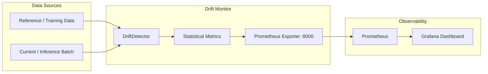

# ML Drift Monitoring

Production data and model drift detection with statistical tests, Prometheus-compatible metrics, and alerting.

## What this project does

Detects distribution drift between a reference (training) dataset and incoming (inference) batches using established statistical methods. Designed to run alongside a model-serving API and feed drift signals into existing monitoring infrastructure.

**Implemented metrics:**

| Metric | What it measures | Best for |
|--------|-----------------|----------|
| PSI (Population Stability Index) | Shift in binned distributions | Categorical features, scorecard models |
| KS (Kolmogorov-Smirnov) | Maximum distance between CDFs | Continuous features, hypothesis testing |
| Wasserstein | Earth-mover distance between distributions | Comparing magnitude of shift |
| Jensen-Shannon divergence | Symmetric information-theoretic distance | Bounded [0, ln 2] comparisons |
| CSI (Characteristic Stability Index) | Per-bin contribution to PSI | Diagnosing which bins shifted |

## Architecture



## Understanding drift types

**Data drift (covariate shift):** Input feature distributions change between training and inference. Example: a model trained on summer data sees winter inputs. PSI and KS detect this directly.

**Concept drift:** The relationship between inputs and outputs changes. Same features, different correct labels. Requires label feedback to detect — statistical tests on features alone will not catch it.

**Label shift (prior probability shift):** The distribution of target classes changes. A fraud model trained on 1% fraud rate encounters 5% fraud rate. Detectable if you have ground-truth labels.

This library focuses on **data drift** detection. For concept drift, you need a feedback loop with ground-truth labels — this library can be extended to support that by comparing predicted vs actual distributions.

## When to use PSI vs KS

**PSI** works well for:
- Scorecard and tabular models
- Monitoring categorical or binned features
- Getting a single interpretable number (< 0.1 = stable, 0.1–0.2 = moderate, > 0.2 = significant)

**Limitations:** PSI is sensitive to bin choice and can miss shifts that happen within bins.

**KS** works well for:
- Continuous features
- When you need a p-value for statistical significance
- Detecting any kind of distributional difference

**Limitations:** KS is sensitive to sample size — large samples will reject even tiny, irrelevant differences.

**Recommendation:** Use both. PSI gives you an interpretable magnitude; KS gives you statistical confidence.

## Quickstart

### Install

```bash
pip install -e .
```

### Run the example

```bash
python examples/run_detection.py
```

### Use in your code

```python
import pandas as pd
from drift_monitor import DriftConfig, DriftDetector

config = DriftConfig(
    psi_threshold=0.2,
    ks_alpha=0.05,
    features=["age", "income", "score"],
)

detector = DriftDetector(config)
detector.set_reference(training_data)

report = detector.detect(incoming_batch)
print(report.summary())
```

## Docker

```bash
docker compose up
```

This starts:
- **Drift monitor** exporter on `:8000/metrics`
- **Prometheus** on `:9090`
- **Grafana** on `:3000` (admin/admin)

## Integration with a model-serving API

```python
from fastapi import FastAPI
from drift_monitor import DriftConfig, DriftDetector
from drift_monitor.prometheus_exporter import update_metrics

app = FastAPI()
detector = DriftDetector(DriftConfig(features=["feat_a", "feat_b"]))
# Load reference data at startup
detector.set_reference(pd.read_csv("data/reference.csv"))

@app.post("/predict")
def predict(payload: dict):
    input_df = pd.DataFrame([payload["features"]])

    # Run prediction
    result = model.predict(input_df)

    # Run drift detection on batch (accumulate and check periodically)
    report = detector.detect(input_df)
    update_metrics(report)

    return {"prediction": result.tolist()}
```

## Project structure

```
ml-drift-monitoring/
├── drift_monitor/
│   ├── __init__.py
│   ├── config.py              # DriftConfig dataclass
│   ├── detector.py            # DriftDetector + DriftReport
│   ├── metrics.py             # PSI, KS, Wasserstein, JS, CSI
│   └── prometheus_exporter.py # Prometheus metrics server
├── monitoring/
│   ├── prometheus.yml         # Prometheus scrape config
│   └── grafana_dashboard.json # Pre-built Grafana dashboard
├── examples/
│   └── run_detection.py       # Runnable example
├── tests/
│   ├── test_metrics.py        # Unit tests for all metrics
│   └── test_detector.py       # Synthetic drift scenario tests
├── Dockerfile
├── docker-compose.yml
├── pyproject.toml
└── .github/workflows/ci.yml
```

## Running tests

```bash
pip install -e ".[dev]"
pytest -v
```

## Related

- [Data Drift Overview](https://iblahlou.github.io/posts/data-drift-overview/) — article covering drift concepts and detection strategies
- [SpellX](https://github.com/IbLahlou/SpellX) — end-to-end MLOps platform where drift monitoring would integrate
- [inference-pipeline-template](https://github.com/IbLahlou/inference-pipeline-template) — production inference scaffold with monitoring hooks
